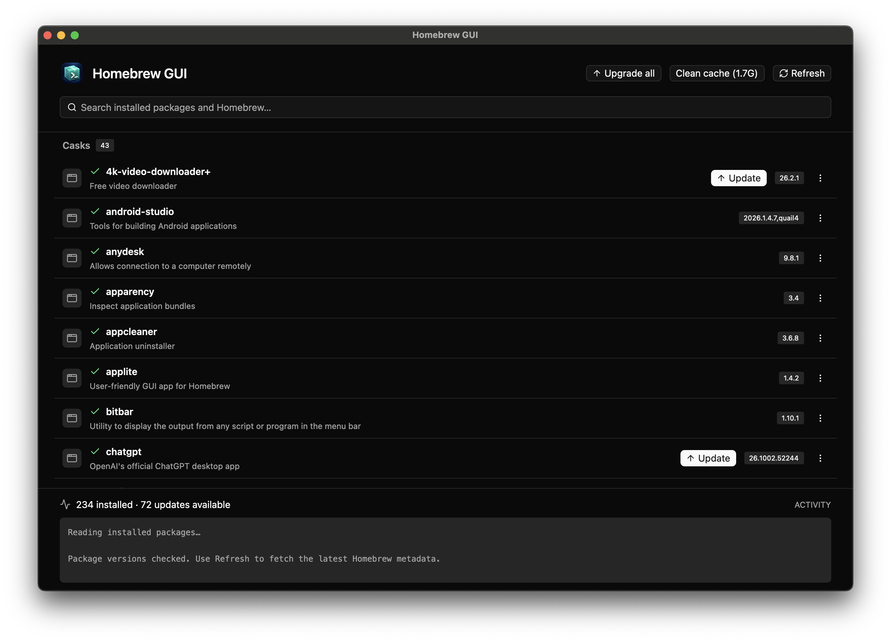

# Homebrew GUI

**Your Homebrew packages, in one native macOS app.**

Find apps and command-line tools, install what you need, and keep your packages up to date without typing Homebrew commands. Homebrew GUI works with your existing Homebrew installation and puts package versions, updates, and live activity in one window.

[Get started](#get-started) · [Features](#features) · [Releases](https://github.com/mzgs/Homebrew-GUI/releases) · [Report an issue](https://github.com/mzgs/Homebrew-GUI/issues)



## Features

- **One search for installed and available packages.** Browse everything you have installed, or type to find more in Homebrew. Results are grouped into **Casks** (macOS apps) and **Formulas** (command-line tools and libraries), without duplicate installed entries.
- **Install, reinstall, and uninstall.** Manage packages from the list. Uninstalling asks for confirmation first.
- **Update one package or upgrade them all.** See installed versions and available updates at a glance. Pinned packages stay pinned and are skipped during upgrades.
- **Explore package details.** Read Homebrew’s package information in the app or open a project’s homepage from the package menu.
- **Find other formula versions.** Use **Install another version…** to search for versioned formulae such as `python@3.13`, when Homebrew provides them.
- **Clean up disk space.** See the size of your Homebrew cache, then remove cached downloads and old package versions with **Clean cache**.
- **Follow every command.** Watch live output and errors in the activity panel. Commands run in the background, one at a time.
- **Feel at home on macOS.** The native Rust interface follows your system’s light or dark appearance and remembers your window size and position.

## Get started

You need **macOS** and an existing [Homebrew](https://brew.sh) installation. Both Apple Silicon and Intel Macs have build targets. Homebrew GUI detects `brew` in your `PATH` and the standard `/opt/homebrew/bin` and `/usr/local/bin` locations.

If Homebrew is new to you, follow the installation instructions at [brew.sh](https://brew.sh) first. Homebrew GUI manages packages through Homebrew; it does not install Homebrew for you.

### Install a release

Check [Releases](https://github.com/mzgs/Homebrew-GUI/releases) for downloadable builds. **If no release is listed, [build from source](#build-from-source) below.**

When a release is available:

1. Download the ZIP for your Mac: **`macos-arm64`** for Apple Silicon, or **`macos-x86_64`** for Intel. You can check your chip in **Apple menu → About This Mac**.
2. Unzip the download and move `homebrew-gui.app` to **Applications**.
3. Open the app. It will read your installed packages automatically.

Release builds are ad-hoc signed and are **not notarized by Apple**. macOS may require approval in **System Settings → Privacy & Security** before a downloaded build can open.

### Build from source

Install stable [Rust](https://www.rust-lang.org/tools/install) and the Xcode Command Line Tools (`xcode-select --install`), then run:

```sh
git clone https://github.com/mzgs/Homebrew-GUI.git
cd Homebrew-GUI
./run.sh
```

To build a release app bundle instead:

```sh
./build.sh
open target/release/homebrew-gui.app
```

You can copy the resulting `.app` to **Applications**. Rust is needed to build the app, but is not needed to run a downloaded build.

## Using Homebrew GUI

1. **Browse your packages.** Leave the search field empty to see installed apps and formulae, with their versions and an installed checkmark.
2. **Find something new.** Type a package name, then choose **Install** beside an available result.
3. **Check for updates.** Click **Refresh** to fetch the latest Homebrew metadata. Choose **Update** on a package or **Upgrade all** for outdated, unpinned packages.
4. **Open package actions.** Use the **⋮** menu on an installed package for details, its homepage, reinstallation, other formula versions, or removal.
5. **Reclaim space.** Choose **Clean cache** when you want to remove cached downloads and old package versions. The button shows the cache’s total size, which is not a guarantee of how much space cleanup will free.

The activity panel shows progress and any errors. Keep the app open until the command finishes. Installs and upgrades can also change dependencies through normal Homebrew behavior.

At startup, the app uses the Homebrew metadata already on your Mac. **Refresh** fetches newer metadata; if that fetch fails, cached package versions remain visible.

## Help and limitations

**Homebrew was not found**

Confirm that `brew --version` works in Terminal, then reopen the app. Standard Apple Silicon and Intel installation paths are detected even when they are missing from the app’s `PATH`.

**A command needs administrator access**

On macOS, commands that need administrator access show a password dialog. The password goes directly to `sudo` and is not saved or logged. An existing `SUDO_ASKPASS` helper is respected.

**A command fails or needs more input**

Read the error in the activity panel. Installers that need interactive input beyond the administrator password may need to be run in Terminal. Tap management and Homebrew services are outside the app’s current scope.

**An older version is not listed**

**Install another version…** searches the versioned formulae Homebrew currently provides. It does not install arbitrary historical versions.

Found a bug or have an idea? [Open an issue](https://github.com/mzgs/Homebrew-GUI/issues) with your macOS version, Mac architecture, app version, and steps to reproduce it. For command failures, include the relevant activity output after removing any personal information.

## Development

Built with [Rust](https://www.rust-lang.org/) and [GPUI Kit](https://github.com/longbridge/gpui-kit). Package operations use Homebrew’s [CLI and JSON output](https://docs.brew.sh/Manpage).

Run the app checks:

```sh
cargo test --locked
```

Check the release script without publishing (Python 3.11+):

```sh
python3 -m unittest discover -s tests
```

To build for a specific Mac architecture, install the matching Rust target and pass it to the build script:

```sh
rustup target add --toolchain stable aarch64-apple-darwin
./build.sh aarch64-apple-darwin

rustup target add --toolchain stable x86_64-apple-darwin
./build.sh x86_64-apple-darwin
```

These bundles are written to `target/<target>/release/homebrew-gui.app`. App bundling requires macOS.

<details>
<summary><strong>Maintainers: publish a release</strong></summary>

Commit all changes, including `.github/workflows/release.yml`, and enable GitHub Actions in the repository. With Python 3.11+ and Git installed, run:

```sh
python3 release.py
```

The script reads the GitHub token already embedded in the HTTPS `origin` URL in `.git/config`; it does not print or copy the token. The token needs repository contents write access and permission to push workflow files (`workflow` scope for a classic token).

It fetches tags, increments the highest stable version from `Cargo.toml` and the tags by one patch, updates `Cargo.toml` and `Cargo.lock`, and commits the version bump. It pushes the current branch and new tag atomically, then prints the GitHub Actions link.

The **Release** workflow runs the Python and Rust tests, builds separate Apple Silicon (`arm64`) and Intel (`x86_64`) app ZIPs, and publishes **Homebrew GUI vVERSION** with generated release notes. The release stays a draft until both ZIPs are uploaded. Bundle versions come from `Cargo.toml`.

Publishing uses GitHub’s automatic `GITHUB_TOKEN` with contents write permission; no extra repository secrets are needed. The script requires no local Rust toolchain, macOS build tools, GitHub CLI, or Python packages. Builds and ZIPs are created in GitHub Actions.

Failures before the version commit restore the original version files. After a release commit exists, failures keep the commit and tag for recovery; retry the atomic push if needed. For build or publication failures, fix the cause and rerun the workflow in GitHub Actions; publication can resume an existing draft. Source fixes require a new commit and release tag.

</details>
